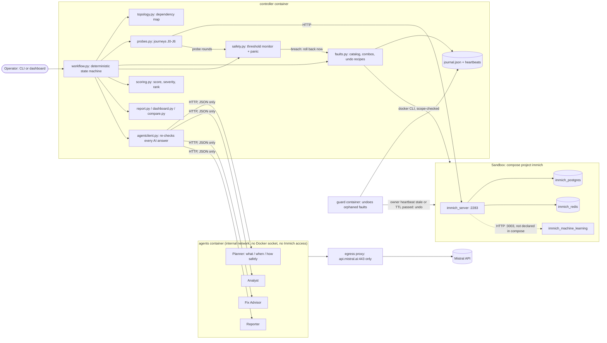

# ShutterStorm: architecture (one page)

Full generated diagrams (Immich topology, runtime, module imports): [DEPENDENCY_GRAPH.md](DEPENDENCY_GRAPH.md).

## Flow of one run
1. **Check** environment and scope; take a checkpoint (container states, CPU limits, system-config, hash of
   every file in IMMICH_DIR).
2. **Discover** the dependency map: compose `depends_on` + Immich's live config (finds server → ML).
3. **Plan** (AI): rank the catalog on the map into a tentative plan with a reason per experiment.
4. **Baseline**: 5 rounds of the 7 journeys (normal error rate, p50/p95).
5. **Repeat up to the budget**:
   * **Decide** (AI): from what this run has shown so far, the next fault (what, now = when), its strength
     (CPU limit, traffic clients, delay/loss), duration and stricter safety limits (how safely). The
     controller clamps everything to hard bounds.
   * **Predict** → **inject** (journal entry per part → guard → 60 s TTL → docker action / load generator)
     → **observe**, the safety monitor checking every round against the AI's limits → **undo and verify**
     (early on a breach) → **recovery** + **integrity** → **score** → **explain** → **suggest a fix** (never applied).
6. **Restore and verify cleanup** (always) → **report** (plan, every AI decision, findings, safety record).

## How the AI decides, and what keeps it safe
| Decision | Who decides | Enforced by the controller (never by the prompt) |
|---|---|---|
| **What** to break | Planner, from map features: criticality, likelihood, blast radius, undeclared dependency, hang style, history, results of this run | catalog faults only; ≥ 3 failure classes, ≤ 2 per service, ≤ 1 combo; invalid → deterministic choice |
| **When** (order, adapting) | Planner, before every experiment; may change its own plan | the choice must be allowed next under the same rules |
| **How hard / how long** | Planner: CPU 0.1-1.0, clients 8-48, delay 500-5,000 ms, loss 5-50 %, 15-45 s | values clamped to these bounds, unknown settings ignored |
| **How safely** | Planner: error-rate and p95 limits per experiment | **stricter-only**: never above the caps (75 %, 8 s); blast radius, TTL, guard always on |
| Explanations, fixes, summary | Analyst, Fix Advisor, Reporter | grounding check; fix allow-list; ranking and severity from the formula |
| Injection, undo, scoring, cleanup | deterministic code | n/a: no AI involved |
| Applying a fix | a human | ShutterStorm has no code path that changes Immich's config or compose files |

## Containers (`deploy/docker-compose.yml`)
| Container | Can | Cannot |
|---|---|---|
| **agents** | call Mistral through the egress proxy | reach Docker, Immich (by name or IP), the host or any other site; write its filesystem |
| **egress** | tunnel to `api.mistral.ai:443` | anything else (refused and logged) |
| **controller** | drive Docker (scope-checked) and Immich, run the dashboard | recreate Immich services; act on an AI answer before re-checking it |
| **guard** | undo journal entries whose owner stopped its heartbeat or whose TTL passed | anything outside the journal's undo recipes |

The same code also runs without containers (`python -m shutterstorm ...`); then the agents run in-process.

## Scoring
`S_e = 100 × (0.30·A + 0.15·L + 0.20·C + 0.15·I + 0.10·R + 0.10·B)`: availability, latency, containment,
integrity, recovery (1 at ≤30 s → 0 at 300 s), bounded failure (fast vs hung).
`severity = (100 − S_e)/100 × criticality × likelihood`. Overall = criticality-weighted mean of `S_e`.

## Safety layers
Scope check on every docker action · fixed catalog · write-ahead journal with verified undo · threshold
monitor with AI-chosen, stricter-only limits · 60 s TTL · dead-man guard (process or container, heartbeat) ·
Ctrl+C / `panic` / `stop` · abort if liveness fails > 30 s after an undo · no fix ever applied · cleanup
verification in every report · AI isolated from Docker and Immich in container mode.
