# ShutterStorm: architecture (one page)

```mermaid
flowchart LR
  subgraph Sandbox["Our sandbox: Docker Desktop, compose project 'immich'"]
    S[immich_server :2283]
    ML[immich_machine_learning]
    R[(immich_redis / BullMQ)]
    DB[(immich_postgres)]
    ML2[immich_machine_learning_2<br/>only while a repair patch is tested]
    S -->|depends_on| DB
    S -->|depends_on| R
    S -. "HTTP :3003 (config only, NOT in compose)" .-> ML
    S -. failover .-> ML2
  end

  subgraph SS["ShutterStorm (python -m shutterstorm)"]
    WF[workflow.py<br/>deterministic state machine]
    P[probes.py<br/>J0..J6 user journeys]
    F[faults.py<br/>catalog + undo recipes]
    T[topology.py<br/>discovery + predictions]
    SC[scoring.py<br/>S_e + severity + rank]
    RP[repair.py<br/>fail-closed validator]
    AG[agents.py<br/>Analyst / Repair / Reporter]
    LLM[llm.py<br/>Mistral + cache + replay]
    J[(journal.json<br/>write-ahead undo)]
    G[guard.py<br/>detached dead-man process]
    REP[report.py<br/>report.md + report.html]
  end

  WF --> T & P & F & SC & RP & AG & REP
  AG --> LLM -->|evidence only, secrets redacted| MI[(api.mistral.ai)]
  P -->|REST API| S
  F -->|docker CLI, scope-checked| Sandbox
  RP -->|system-config API + override file| Sandbox
  F --> J
  G --> J
  G -->|undo if owner died / TTL passed| Sandbox
```

## Workflow (control flow is plain code)
1. **Check environment, scope and clean checkpoint**: containers healthy and labelled `immich`, journal
   empty, no helpers. The checkpoint stores container states, CPU limits, the full system-config, the
   override-file state and a SHA-256 of every file in `IMMICH_DIR` (except `library/`).
2. **Discover** the dependency map from three sources: `compose` (depends_on), `config` (Immich's
   `machineLearning.urls`, DB/Redis hosts) and `empirical` (journeys that broke under a fault).
3. **Baseline**: 5 rounds of J0..J6, p50/p95.
4. Per fault: **predict** (dependency map + Analyst) → **inject** (journal entry → guard → TTL timer →
   docker action) → **observe** ~35 s of concurrent probe rounds + queue snapshots + log tails → **undo and
   verify** → measure **recovery** → check **integrity** of uploads made during the fault (including ghost
   uploads found by file name).
5. **Score** (math), **analyse** (Analyst), optional **repair loop**, then the **report** (Reporter).
6. **Restore and verify cleanup**: always (`finally`), also after an error, STOP or Ctrl+C.

## Where AI is used, and where it is not
| Step | AI? | Notes |
|---|---|---|
| Impact prediction | Analyst (LLM) + deterministic map | precision/recall scorecard; mismatches are findings |
| Explaining a finding | Analyst | root cause, user-visible symptom, severity rationale |
| Proposing a fix | Repair agent | only allowed knobs; sees previous attempts and their results |
| Writing the report | Reporter | must keep the math's order and severities |
| Fault choice, injection, undo, timing | **no** | fixed catalog, deterministic code |
| Patch validation, pass/fail, retries | **no** | fail-closed validator + measured criteria |
| Ranking and resilience score | **no** | `scoring.py` formula |

Every AI output is schema-checked (one retry on invalid JSON, then a deterministic fallback) and tagged
`live`, `cache` or `fallback` in the report. `LLM_MODE=replay` serves only cached answers for a reliable demo.
Free-tier limits: ~1 request/s, backoff with jitter on 429/5xx, 40-call budget per run, SHA-256 disk cache.

## Scoring
`S_e = 100 × (0.30·A + 0.15·L + 0.20·C + 0.15·I + 0.10·R + 0.10·B)`: availability, latency, containment,
integrity, recovery (1 at ≤30 s → 0 at 300 s), bounded failure (fast vs hung).
`severity = (100 − S_e)/100 × criticality × likelihood` (DB 1.0, server 1.0, Redis 0.8, ML 0.6;
pause/stop 0.5, restart 0.8, throttle/latency 0.6). Overall score = criticality-weighted mean of `S_e`.

## Repair pass criteria (all must hold)
Only `docker-compose.shutterstorm.yml` changed in `IMMICH_DIR` · protected journeys J0, J1, J2, J6 pass with
the patch · the **same** fault re-injected improves the target journey (hung→fast error or fail→pass) and
`S_e` rises by ≥ 10 · the fault undo is verified. A verified patch is saved (`patches/<fault>.json` + `.diff`)
and reverted, unless `--keep-fix`.

## Safety layers
Scope check on every docker action · fixed fault catalog · write-ahead journal with verified undo ·
TTL watchdog thread · detached dead-man guard process · Ctrl+C / `panic` / STOP file · abort if liveness
fails > 30 s after an undo · fail-closed repair validator · changed-files hash check · cleanup verification
in every report · probe assets deleted only by tracked ID **and** `shutterstorm-probe-` file name.
