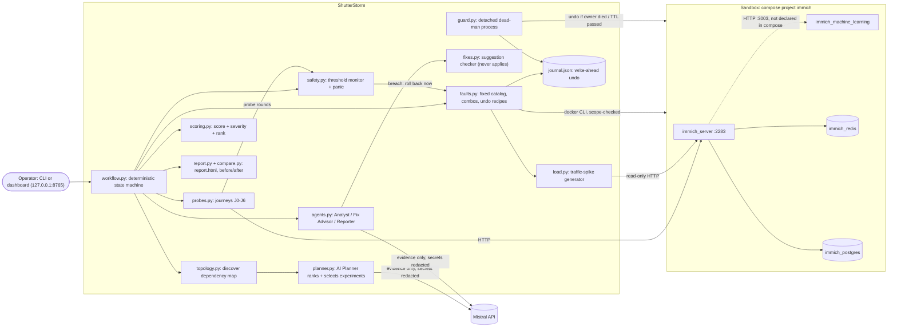

# ShutterStorm: architecture (one page)

Full generated diagrams (Immich topology, runtime, module imports): [DEPENDENCY_GRAPH.md](DEPENDENCY_GRAPH.md).

## Flow of one run
1. **Check** environment and scope; take a checkpoint (container states, CPU limits, system-config, hash of
   every file in IMMICH_DIR).
2. **Discover** the dependency map: compose `depends_on` + Immich's live config (finds server → ML).
3. **Plan** (AI): rank the fault catalog on the map and pick N experiments with a reason each (below).
4. **Baseline**: 5 rounds of the 7 journeys (normal error rate, p50/p95, health).
5. Per planned experiment: **predict** (map + AI) → **inject** (journal entry per part → guard → 60 s TTL
   → docker action / load generator) → **observe** ~35 s, the **safety monitor** checking every round →
   **undo and verify** (early if a threshold was breached) → **recovery** and **integrity** →
   **score** (formula) → **explain** (Analyst) → **suggest a fix** (Fix Advisor; shown, never applied).
6. **Restore and verify cleanup** (always) → **report** (optionally with before/after vs an earlier run).

## How the AI makes decisions
| Decision | Who decides | How it is kept honest |
|---|---|---|
| **Which experiments, in which order** | **Planner (LLM)** over deterministic features: criticality × likelihood, blast radius from the map, undeclared dependencies, hang-style faults, history of earlier runs | Validator: catalog faults only, exact budget, ≥ 3 failure classes, ≤ 2 per service, ≤ 1 combo, numbers grounded; otherwise the deterministic priority ranking is used |
| Impact prediction | Analyst (LLM) + deterministic map | precision/recall scorecard in every report |
| Explaining a finding | Analyst (LLM) | checked for invented numbers / other faults; else template |
| Suggesting a fix | Fix Advisor (LLM) | only allowed settings pass the checker; never applied, never tested by us |
| Executive summary | Reporter (LLM) | must keep the formula's order and severities |
| Safety limits, injection, undo, timing, cleanup | **deterministic code** | fixed catalog, thresholds from config |
| Score, severity, ranking, before/after verdict | **deterministic code** | `scoring.py`, `compare.py` |
| Applying fixes | **a human** | ShutterStorm has no code path that changes Immich's config or compose files |

Deterministic planner priority = 0.55 × risk + 0.45 × novelty + 0.15 (undeclared dependency) + 0.10
(hang-style) + 0.10 (combo); every service in the map is covered first. Every AI output is tagged `live`,
`cache` or `fallback`; `LLM_MODE=replay` serves cached answers only.

## Scoring
`S_e = 100 × (0.30·A + 0.15·L + 0.20·C + 0.15·I + 0.10·R + 0.10·B)`: availability, latency, containment,
integrity, recovery (1 at ≤30 s → 0 at 300 s), bounded failure (fast vs hung).
`severity = (100 − S_e)/100 × criticality × likelihood` (DB/server 1.0, Redis 0.8, ML 0.6; pause/stop 0.5,
restart 0.8, load 0.7, cpu/latency/loss 0.6, combo 0.4). Overall = criticality-weighted mean of `S_e`.

## Safety controls
**Threshold monitor** after every probe round: error rate > 75 %, p95 > 8 s, or a journey outside the blast
radius (one that does not depend on the faulted service) fails → immediate rollback, experiment marked
AUTO-STOPPED · scope check on every docker action · fixed fault catalog · write-ahead journal with verified
undo · 60 s TTL watchdog · detached dead-man guard · Ctrl+C / `panic` / `stop` (also dashboard buttons) ·
abort if liveness fails > 30 s after an undo · no fix is ever applied · cleanup verification in every report.
