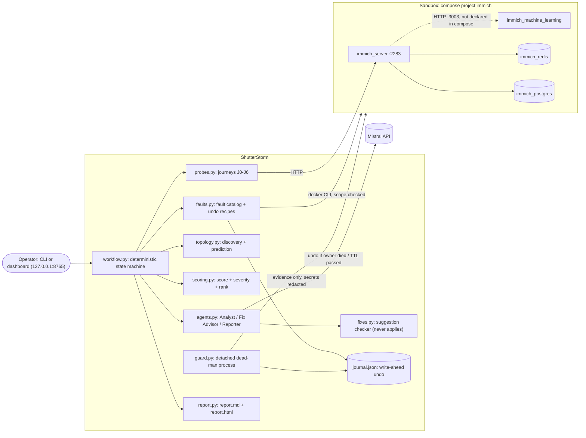

# ShutterStorm: architecture (one page)

Full generated diagrams (Immich topology, runtime, module imports): [DEPENDENCY_GRAPH.md](DEPENDENCY_GRAPH.md).

## Flow of one run
1. **Check** environment and scope; take a checkpoint (container states, CPU limits, system-config, hash of
   every file in IMMICH_DIR).
2. **Discover** the dependency map: compose `depends_on` + Immich's live config (finds server → ML).
3. **Baseline**: 5 rounds of the 7 journeys (p50/p95).
4. Per fault: **predict** (map + AI) → **inject** (journal entry → guard → 60 s TTL timer → docker action)
   → **observe** ~35 s (concurrent probe rounds, queue snapshots, log tails) → **undo and verify**
   → **recovery** and **integrity** of uploads made during the fault → **score** (formula)
   → **explain** (Analyst) → **suggest a fix** (Fix Advisor; checked against allowed settings; shown, never applied).
5. **Restore and verify cleanup** (always) → **report**.

## Where AI is used, and where it is not
| Step | AI? | Notes |
|---|---|---|
| Impact prediction | Analyst + deterministic map | precision/recall scorecard |
| Explaining a finding | Analyst | checked for invented numbers / other faults; else template |
| Suggesting a fix | Fix Advisor | only allowed settings pass the checker; never applied, never tested |
| Executive summary | Reporter | must keep the formula's order and severities |
| Fault choice, injection, undo, timing, cleanup | **no** | fixed catalog, deterministic code |
| Score, severity, ranking | **no** | `scoring.py` |
| Applying fixes | **nobody** | ShutterStorm has no code path that changes Immich's config or compose files |

Every AI output is tagged `live`, `cache` or `fallback` (template). `LLM_MODE=replay` serves cached answers only.

## Scoring
`S_e = 100 × (0.30·A + 0.15·L + 0.20·C + 0.15·I + 0.10·R + 0.10·B)`: availability, latency, containment,
integrity, recovery (1 at ≤30 s → 0 at 300 s), bounded failure (fast vs hung).
`severity = (100 − S_e)/100 × criticality × likelihood` (DB/server 1.0, Redis 0.8, ML 0.6; pause/stop 0.5,
restart 0.8, throttle/latency 0.6). Overall = criticality-weighted mean of `S_e`.

## Safety layers
Scope check on every docker action · fixed fault catalog · write-ahead journal with verified undo ·
TTL watchdog · detached dead-man guard · Ctrl+C / `panic` / `stop` (also dashboard buttons) · abort if
liveness fails > 30 s after an undo · no fix is ever applied · cleanup verification in every report ·
probe photos deleted only by tracked ID **and** `shutterstorm-probe-` file name.
