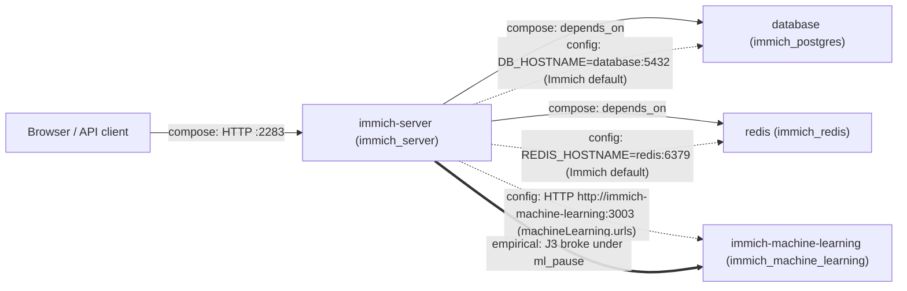
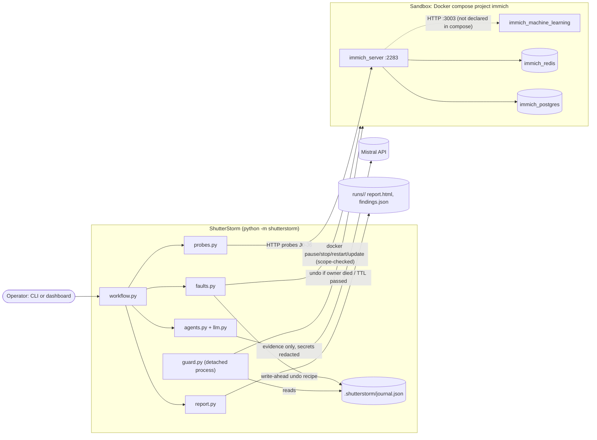
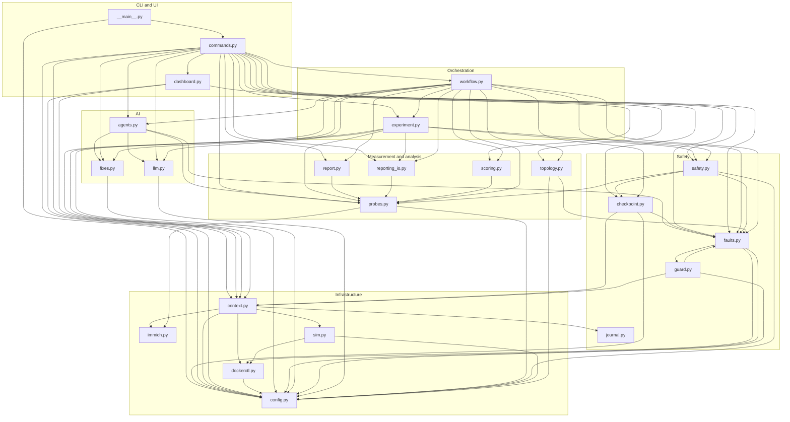

# Dependency graphs

Generated by `python -m shutterstorm.depgraph` (do not edit by hand). Diagrams are Mermaid
(GitHub renders them; the dashboard shows them at http://127.0.0.1:8765/graph).

## 1. Immich system under test (discovered, not hand-drawn)

Source: `runs/20261010-161445-run/topology.json`, built by `discover` from three sources:
solid = `compose` (depends_on), dashed = `config` (Immich's live `machineLearning.urls`,
DB/Redis host settings), thick = `empirical` (a journey broke when that service was faulted).
The server -> ML dependency is **not declared in compose**; it is only visible in config and in experiments.

Which user journey needs which service (used for the deterministic impact prediction):

| Journey | What it does | Needs |
|---|---|---|
| J0 | liveness (ping) | server |
| J1 | login | server, database |
| J2 | browse (metadata search) | server, database |
| J3 | smart search (ML) | server, database, ml |
| J4 | upload | server, database, redis |
| J5 | async processing (thumbnail) | server, database, redis |
| J6 | integrity (SHA-1 of original) | server, database |

## 2. Runtime: how ShutterStorm interacts with the sandbox

## 3. ShutterStorm code: module import graph (23 modules, 74 internal imports)

Derived from the `import` statements of every module in `shutterstorm/` (including imports inside
functions). An arrow `a --> b` means `a.py` imports `b.py`.

### Module list

| Module | Imports | External system |
|---|---|---|
| `__main__.py` | commands, config | - |
| `agents.py` | faults, fixes, llm, probes | - |
| `checkpoint.py` | config, context, faults | - |
| `commands.py` | agents, checkpoint, config, context, dashboard, experiment, faults, fixes, llm, probes, report, reporting_io, safety, scoring, topology, workflow | - |
| `config.py` | - | - |
| `context.py` | config, dockerctl, immich, journal, sim | - |
| `dashboard.py` | config, context, faults | Browser (127.0.0.1:8765) |
| `dockerctl.py` | config | Docker CLI (subprocess) |
| `experiment.py` | config, context, faults, probes, reporting_io, safety | - |
| `faults.py` | config, dockerctl, guard | - |
| `fixes.py` | config | - |
| `guard.py` | config, context, faults | - |
| `immich.py` | - | Immich REST API :2283 |
| `journal.py` | - | - |
| `llm.py` | config | Mistral API (HTTPS) |
| `probes.py` | config, immich | - |
| `report.py` | probes | - |
| `reporting_io.py` | probes | - |
| `safety.py` | checkpoint, config, faults, probes | - |
| `scoring.py` | probes | - |
| `sim.py` | config, dockerctl | - |
| `topology.py` | config, faults | - |
| `workflow.py` | agents, checkpoint, context, experiment, faults, fixes, llm, probes, report, reporting_io, safety, scoring, topology | - |
